# ThreatLens — Security Log Triage Dashboard

## Evals, LLM judge and fine-tune (new)

ThreatLens now ships a full evaluation setup on top of the detector. Details and the exact commands are in [VERIFY.md](VERIFY.md).

| What | Result (held-out test split, 203 lines) |
|---|---|
| Rules only | F1 0.740 |
| Rules + Gemini flash-lite | F1 0.991 (P 0.991, R 0.991) |
| Rules + Groq gpt-oss-20b | F1 0.963 |
| Rules + QLoRA Qwen2.5-0.5B (local, 8 GB GPU) | F1 0.748, $0 per call, offline |
| LLM-as-judge agreement with labelled explanations | Cohen's kappa 0.29 -> 0.75 |

- `evals/golden/` 371-line labelled golden set (dev/test split, 47 hard negatives, 18 categories); see LABELING.md.
- `evals/run.py --provider rules|gemini|groq|local --split test` runs the real pipeline and reports per-category P/R/F1, tokens, cost, p50/p95.
- `evals/judge/` LLM-as-judge calibrated against hand labels; `promptfooconfig.yaml` regression suite; env-gated Langfuse tracing.
- `evals/finetune/` QLoRA training with a train/test overlap filter (0 overlap), model card and [head-to-head](evals/finetune/HEAD_TO_HEAD.md). The fine-tune loses to the API models on F1; it is reported as measured.
- `.github/workflows/evals.yml` fails the build if recall/F1 drop below thresholds.

Caveats: the logs are synthetic, labels come from one annotator, and each LLM configuration was run once.


> A session-scoped security log triage dashboard for nginx and Linux auth events. Paste logs, the backend runs deterministic rules for common attacks, sends unmatched lines to a Groq-hosted LLM (gpt-oss) for advisory classification, and shows prioritized explanations in a session-scoped feed.

**Live demo:** https://threatlenss.vercel.app — backend: https://threatlens-qd5e.onrender.com


---

## Try it live — 60 seconds

1. Open the [demo](https://threatlenss.vercel.app)
2. Click **"Load sample file (GitHub)"** in the upload panel — a mixed attack/benign log set is fetched straight from this repo (or download it below)
3. Click **Analyze Logs** and watch the pipeline strip: Parse → Redact → Rules → LLM → Store
4. Click any flagged threat for an analyst brief (MITRE tactic + explanation + recommended actions)

| Asset | Link |
|---|---|
| Sample file (full) | [Download `sample_attack_logs.log`](https://raw.githubusercontent.com/mathuryashash/ThreatLens/main/sample_attack_logs.log) |
| Sample contents & demo walkthrough | [docs/SAMPLE_LOGS.md](docs/SAMPLE_LOGS.md) |

The sample contains SQLi, SSRF, XSS, path traversal, SSH brute force (auth format), privilege escalation, recon, credential stuffing and benign traffic — in **both** nginx and Linux auth log formats.

---

## What it does

1. Parses and normalizes nginx access logs / Linux auth logs
2. Runs deterministic rules (SQLi, brute force, path traversal, SSRF, XSS, privilege escalation)
3. Sends unmatched logs to the LLM for advisory classification
4. Displays a live threat feed with severity badges
5. Click any threat for a plain-English Analyst Brief (MITRE tactic + explanation + recommended actions)

**All output is advisory only. No automated blocking, no agent, no login required.**

---

## Features

- **No signup** — paste logs directly for triage
- **Log upload** — paste / drag-and-drop file (3MB / 500 lines / 8KB per line)
- **Sample log file** — `sample_attack_logs.log` at repo root, downloadable in-app or via [raw GitHub](https://raw.githubusercontent.com/mathuryashash/ThreatLens/main/sample_attack_logs.log) (see [docs/SAMPLE_LOGS.md](docs/SAMPLE_LOGS.md))
- **One-click incident scenarios** — SSH Brute Force, SSRF Probe, SQL Injection, Priv Esc, Mixed Scan
- **Deterministic rule engine first** — cheap, fast, reliable (ADR-0001)
- **Groq LLM classifier** — catches edge cases rules miss; 20 lines/batch, 5 concurrent
- **3-second polling feed**, severity badges, stats cards, demo reset
- **Prompt injection defense** — logs wrapped in `<logs>` XML tags, labeled untrusted
- **LLM hallucination check** — `source_ip` validated against parsed events before storage

---

## Tech Stack

| Layer | Tool |
|---|---|
| Frontend | Next.js 16 App Router, React 19, Tailwind 4 — **Vercel** |
| Backend | FastAPI (Python, slowapi rate limits) — **Render** |
| Database | Supabase PostgreSQL (in-memory mock fallback) |
| AI | Groq `openai/gpt-oss-20b` (classify), `openai/gpt-oss-120b` (explain), overridable via `GROQ_CLASSIFY_MODEL` / `GROQ_EXPLAIN_MODEL`; optional Gemini swap (`LLM_PROVIDER=gemini`, `GEMINI_MODEL`, default `gemini-flash-lite-latest`) |

---

## Quickstart (Local)

```bash
# Backend — http://localhost:8000
cd backend
cp .env.example .env        # fill keys; ALLOW_MOCK_DB=true for keyless demo
pip install -r requirements.txt
uvicorn main:app --reload --port 8000

# Frontend — http://localhost:3000
cd frontend
cp .env.example .env.local  # NEXT_PUBLIC_API_URL=http://localhost:8000
npm install
npm run dev
```

Supabase optional: apply `docs/optional/DATABASE_SCHEMA.md` SQL, else run with `ALLOW_MOCK_DB=true`.

---

## Deployment & Connection Settings

### Vercel (frontend)

| Setting | Value |
|---|---|
| Root Directory | `frontend` |
| Framework | Next.js |
| `NEXT_PUBLIC_API_URL` | `https://threatlens-qd5e.onrender.com` (no trailing `/`) |

### Render (backend)

| Setting | Value |
|---|---|
| Start command | `uvicorn main:app --host 0.0.0.0 --port $PORT` |
| `SUPABASE_URL` + `SUPABASE_SERVICE_ROLE_KEY` | Supabase project |
| `GROQ_API_KEY`, `LLM_PROVIDER=groq` | LLM |
| `GROQ_CLASSIFY_MODEL`, `GROQ_EXPLAIN_MODEL`, `GEMINI_MODEL` | Model ids (defaults: `openai/gpt-oss-20b`, `openai/gpt-oss-120b`, `gemini-flash-lite-latest`) |
| `LLM_CONCURRENCY`, `LLM_MAX_RETRIES`, `LLM_RETRY_MAX_WAIT`, `GROQ_REASONING_EFFORT` | LLM throughput tuning (defaults 5 / 6 / 30s / low). Groq free tier is ~8k tokens/min, so 429s are retried with backoff |
| `FRONTEND_ORIGIN` | `https://threatlenss.vercel.app` — must byte-match; **no trailing slash** |
| `ALLOW_MOCK_DB` | `false` |

Render free tier sleeps idle — keep the `/api/health` endpoint pinged externally (e.g. UptimeRobot, 5-min interval) and the in-app keepalive loop stays warm.

### Known connection gotchas (all handled in code)

| Symptom | Cause | Fix |
|---|---|---|
| "API Server offline" in browser | CSP `connect-src` missing backend domain (Next.js headers) | whitelist `https://*.onrender.com` in `next.config.ts` |
| Requests refused silently | CORS — `FRONTEND_ORIGIN` mismatch (byte-exact) | set exact Vercel URL |
| Stuck "offline" while server healthy | rate limit keyed on shared Cloudflare edge IP | `cf-connecting-ip` key in `main.py` |
| Slow first load | Render free-tier spin-down | external monitor ping |

---

## Architecture

```mermaid
flowchart LR
    U["Browser (Next.js, polls /api/threats every 3s)"]
    A["Analyst brief on threat click"]

    U -->|"POST /api/ingest"| API["FastAPI"]
    API --> P["Parser"]
    P --> R["Redactor"]
    R --> X["Rules engine"]
    X -->|"unmatched, ≤20/batch"| L["Groq openai/gpt-oss-20b"]
    X -->|"matched"| T[("Supabase / MockDB")]
    L -->|"classifications"| T
    T -->|"session-scoped feed"| U
    U -->|"POST /api/explain"| E["Groq openai/gpt-oss-120b"]
    E -->|"cached briefs"| T

    style L fill:#3b0764,stroke:#a855f7
    style E fill:#3b0764,stroke:#a855f7
    style T fill:#052e16,stroke:#22c55e
```



See [docs/ARCHITECTURE.md](docs/ARCHITECTURE.md).

---

## Scope & Limitations

**Is:** demo-grade triage · nginx/auth logs · rules-first, AI-assisted · session-scoped, no accounts · advisory only

**Is NOT:** a SIEM/WAF/IDS · continuous ingestion · automated response · retention system · guaranteed detection

- Session IDs are demo namespace tokens, not credentials (ADR-0004)
- Redaction is best-effort — never upload production secrets
- LLM output is advisory and can misclassify; rules run first (ADR-0001)

---

## Documentation

| Doc | Purpose |
|---|---|
| [SAMPLE_LOGS.md](docs/SAMPLE_LOGS.md) | Sample attack log file — contents & how to demo |
| [DEPLOYMENT.md](docs/DEPLOYMENT.md) | Full deploy guide (Vercel + Render + Supabase) |
| [API_SPEC.md](docs/API_SPEC.md) | API reference |
| [ARCHITECTURE.md](docs/ARCHITECTURE.md) | System diagrams |
| [PRD.md](docs/PRD.md) / [TECHNICAL_DESIGN.md](docs/TECHNICAL_DESIGN.md) | Requirements & design |
| [SECURITY.md](docs/SECURITY.md) | Security design |
| [ERD.md](docs/ERD.md) / [TEST_PLAN.md](docs/TEST_PLAN.md) | Schema & tests |
| [DEMO_SCRIPT.md](docs/DEMO_SCRIPT.md) | Demo script |

---

## License

Hackathon project — Yashash Mathur